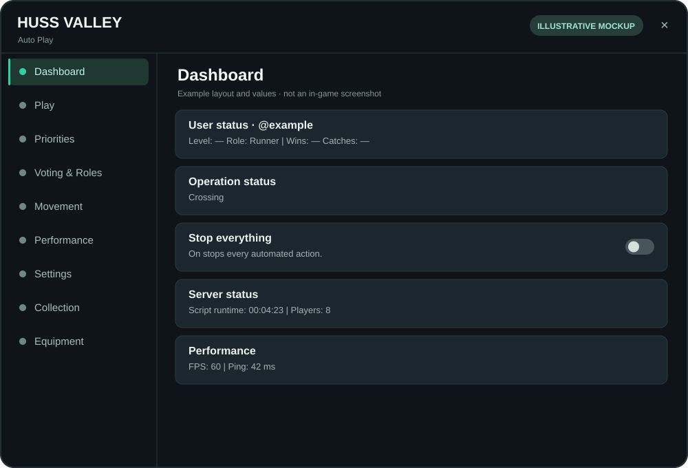
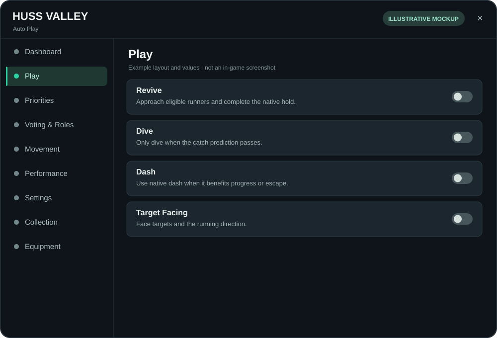
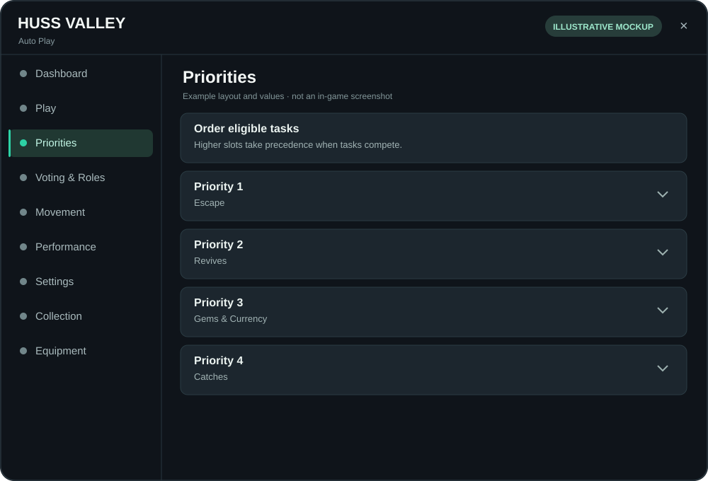
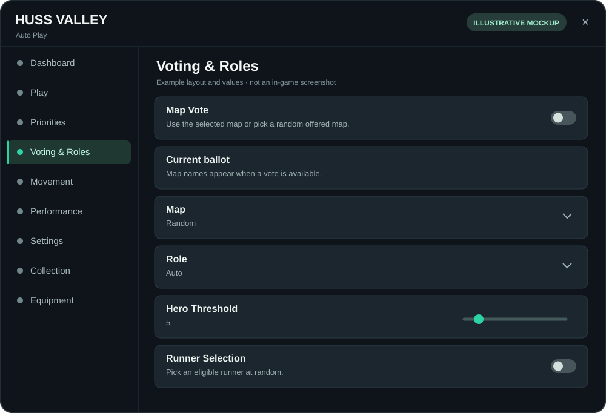
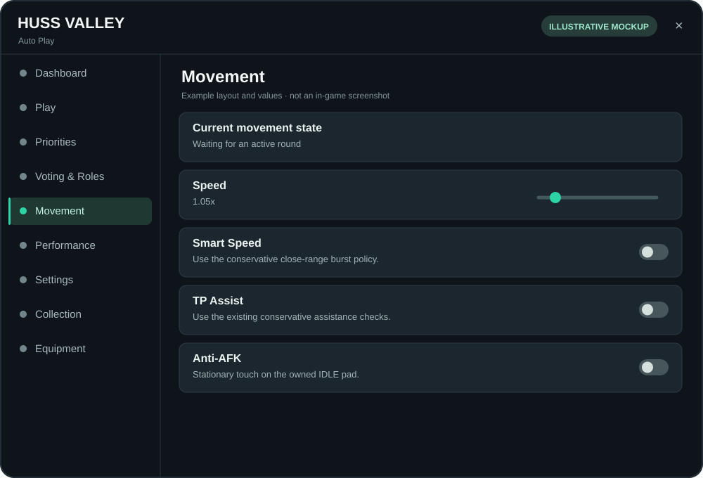
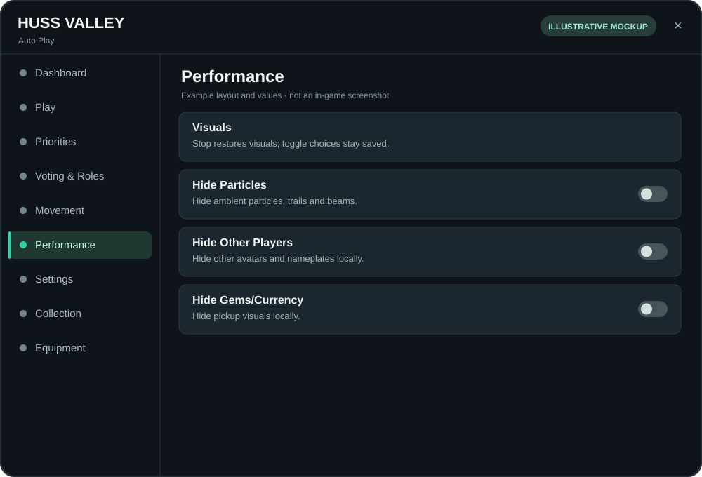
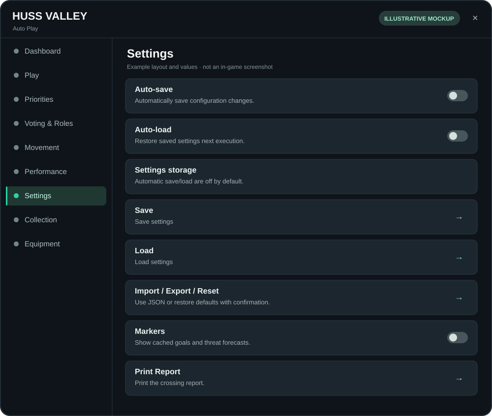
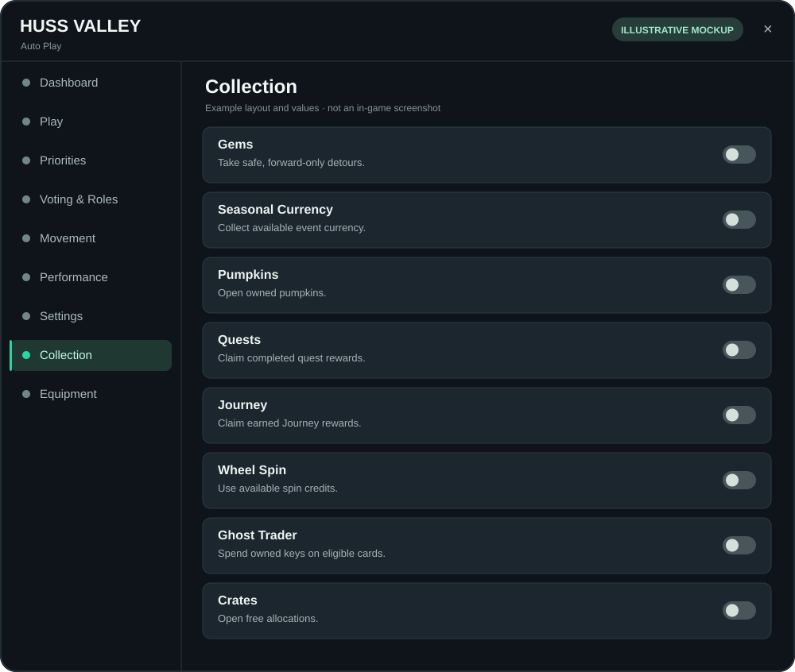
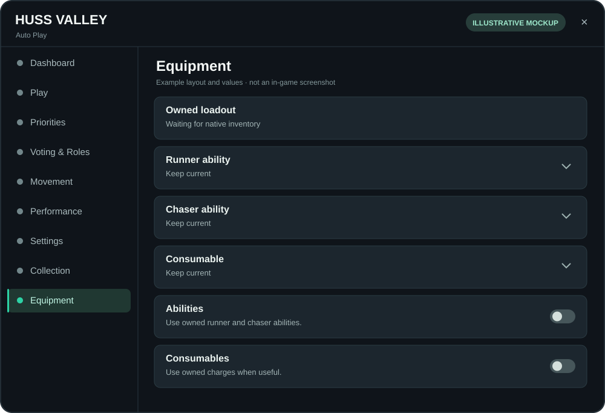

# Huss Valley Auto

**[Open the executable Lua](src/auto-play.lua)** · **[Raw script](https://raw.githubusercontent.com/BubbleGB/Huss-Valley-Auto/main/src/auto-play.lua)**

```lua
loadstring(game:HttpGet("https://raw.githubusercontent.com/BubbleGB/Huss-Valley-Auto/main/src/auto-play.lua"))()
```

Updates are published here. The loadstring stays the same; no Delta workspace copy is needed.

## Controls

Core runner/chaser play starts running unless saved settings stop it. Optional toggles default off. **Dashboard → Stop everything** pauses automation. **Settings → Auto-save / Auto-load** preserves your chosen settings.

The top-bar minus minimizes to a draggable **Huss / Valley** square. Tap the square to restore; **X** unloads. Target Facing aligns the view and body while preserving normal zoom and pitch, and yields to native menus and cinematic cameras.

Dashboard contains user status, server status, operation status and performance measurements. Performance contains the visual reduction toggles. Collection handles gems, seasonal currency, quests, Journey, Wheel Spin, Ghost Trader and free crates through native touch controls. Equipment lists owned items.

## Interface previews

These are **illustrative mockups**, recreated from the script's UI code. They are not in-game screenshots; appearance, values and scroll position may differ. Select an image to view it full size.

| Dashboard | Play | Priorities |
| --- | --- | --- |
| [](docs/images/tab-mockups/dashboard.svg) | [](docs/images/tab-mockups/play.svg) | [](docs/images/tab-mockups/priorities.svg) |
| **Voting & Roles** | **Movement** | **Performance** |
| [](docs/images/tab-mockups/voting-roles.svg) | [](docs/images/tab-mockups/movement.svg) | [](docs/images/tab-mockups/performance.svg) |
| **Settings** | **Collection** | **Equipment** |
| [](docs/images/tab-mockups/settings.svg) | [](docs/images/tab-mockups/collection.svg) | [](docs/images/tab-mockups/equipment.svg) |

## Navigate

| Looking for | Start here |
| --- | --- |
| Controls and behavior | [Usage](docs/usage.md) · [UI/settings](docs/ui-settings.md) |
| Editable Lua | [Source index](src/README.md) · [Ordered manifest](src/manifest.json) |
| Build and contribute | [Development](docs/development.md) |
| Tests and current verification | [Testing](docs/testing.md) · [Fixtures](tests/README.md) |
| Downloadable artifacts | [Distribution](dist/README.md) |
| Final audit and pending live checks | [Offline audit](docs/final-offline-audit.md) · [Live checklist](docs/final-audit-live-checklist.md) |
| Earlier reports and feature notes | [Archive](archive/README.md) |

The main executable is generated from focused source units. The interface loads pinned WindUI 1.6.66; its original source and license remain in `vendor/`. This repository contains the automation project, not the game's server source or place export.
